<p align="center">
  
</p>

<h1 align="center">Nuqta Shahn · نقطة شحن</h1>

<p align="center">
  The accounts of a real phone-charging point, moved from two paper notebooks to a web app used every day on a phone.
</p>

<p align="center">
  <a href="https://github.com/musab-darwish/charging-point/actions/workflows/tests.yml"></a>
  
  
  <a href="LICENSE"></a>
</p>

<p align="center">
  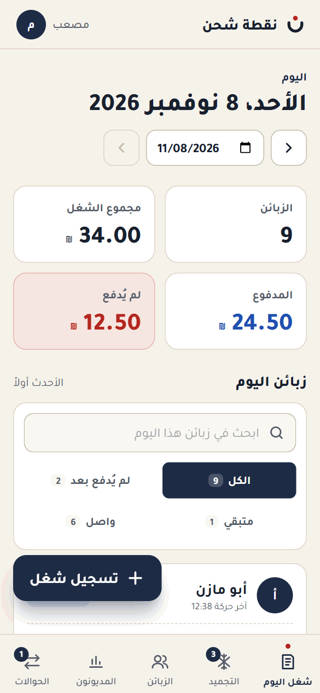
</p>

---

## The story: two notebooks

I run a charging point: people leave their phones, power banks, batteries and laptops to charge, and pay when they collect them. For a long time everything lived in two notebooks.

- **The day notebook.** A date at the top of the page, then one line per customer, usually a nickname, and what they brought: a phone, two phones, a power bank, an 8-amp battery, a laptop, something to freeze, a drink. No prices, everyone knew them. A line was crossed out once it was paid, in cash or by app transfer, or once it moved to the other notebook.
- **The debt notebook.** One line per customer where the days piled up: `(2)+(3)+(6)`, then "transferred so much", then "so much left", and crossed-out amounts that had been paid.

It worked, until it didn't. Every total was added up by hand. A crossed-out line never said *why* it was crossed out. Nobody knew who had written what. And a notebook can get lost.

<p align="center">
  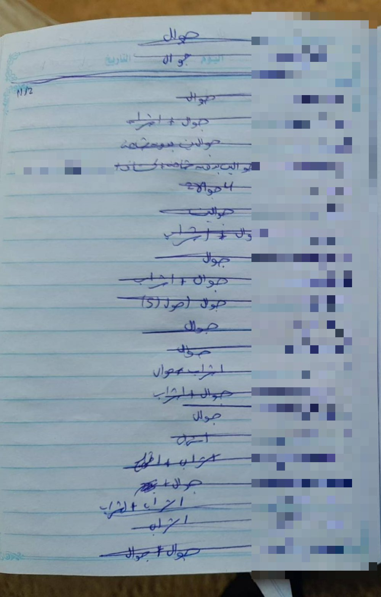
  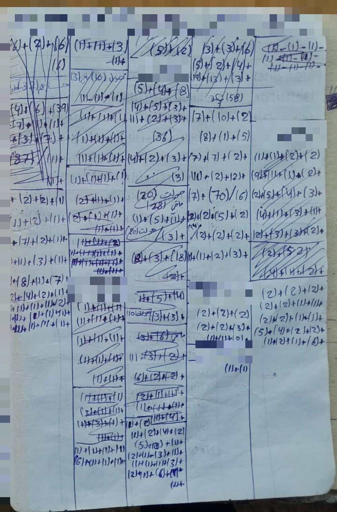
</p>

<p align="center"><sub>The real notebooks: a page of the day notebook, and a page of the debt notebook. The customers' names are pixelated.</sub></p>

**Nuqta Shahn** replaces both notebooks with one system: the day's work is priced as it's recorded, every item lands on the customer's account the moment it's written down, and each customer has a running balance, a statement by day, and an account message ready to send on WhatsApp.

It's been in daily use at the charging point since November 2026.

## What it does

- **Today's work** is the home screen. Pick a customer (search, the walk-in customer, or a new name), tap the items, record. Each customer gets a card for the day showing what they left and whether it's *paid*, *not paid yet* or *partly paid*. Any past day opens the same way, like turning back the pages of the notebook.
- **Payments**, in cash or by app transfer to one of the shop's accounts. A transfer counts straight away and waits for the owner to confirm it arrived.
- **Customer pages** with the balance and a statement grouped by day, newest first, with the running balance at the end of each day.
- **Debtors list**, highest balance first, with each customer's last payment and how long ago it was. The owner can export it to Excel.
- **Account message**: a short version (last payment, what came after, what's owed now) or the full statement, ready to copy, send on WhatsApp or by SMS.
- **The freezer**: items left for days, with a day counter, priced when they're collected.
- **Corrections, not deletions**: a mistake is undone by an opposite record with a required reason, and stays visible, struck through.
- **Old debts** carried over from the paper notebook, once per customer.
- **Users**: the owner adds workers; everyone's records are signed with their name. Sign-in by fingerprint on the phone (passkeys), and the app installs on the home screen.

## Screenshots

| | |
| --- | --- |
| 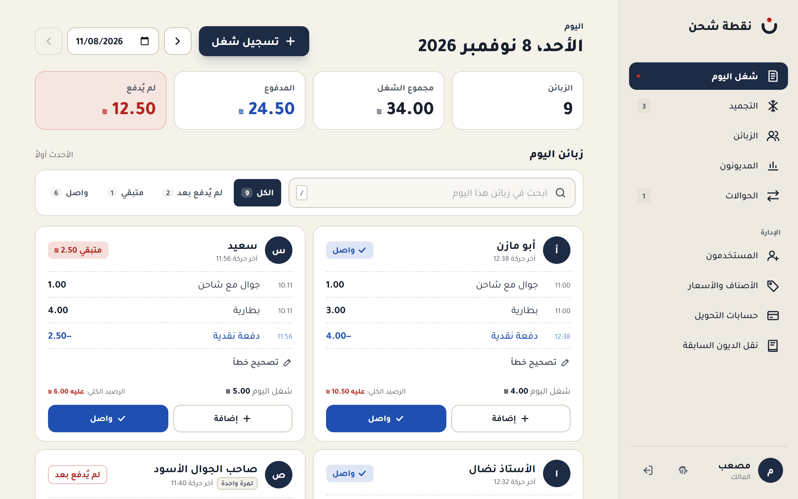 | 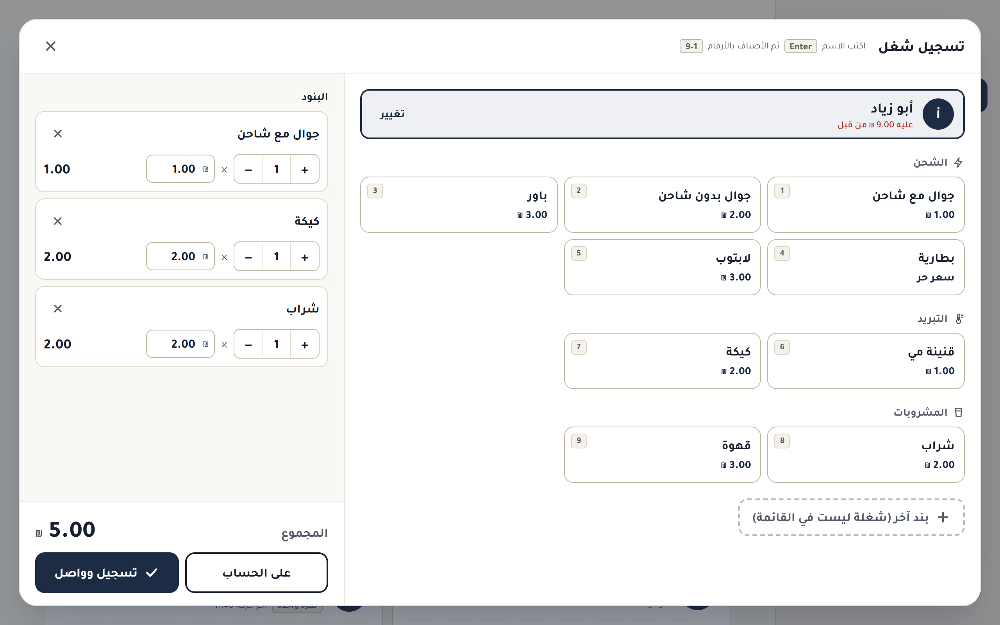 |
| **Today's work**: the day's customers, their items and status | **Recording work**: customer, items, quantity and price |
| 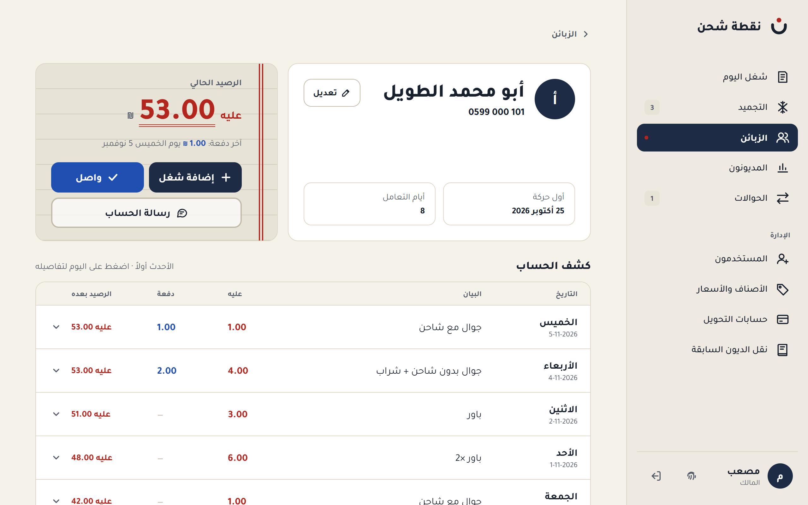 | 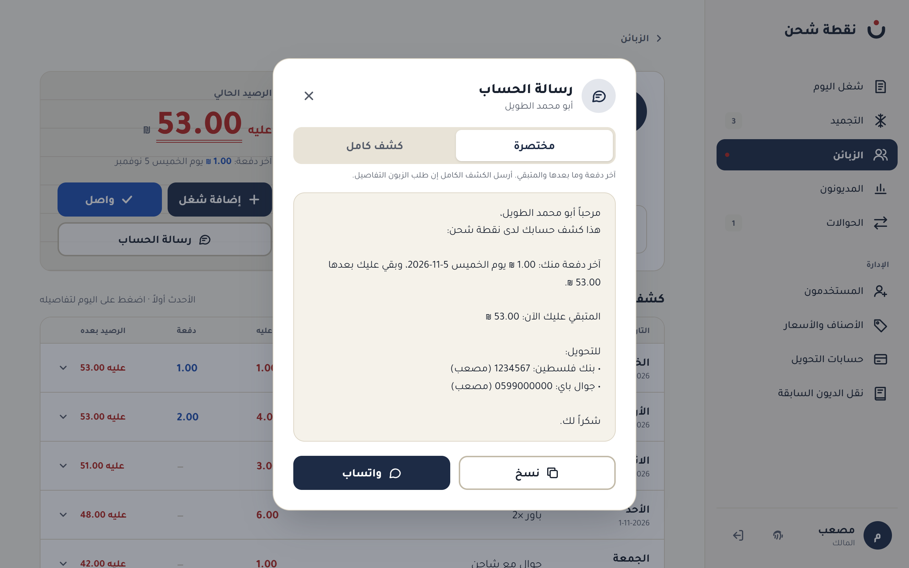 |
| **A customer**: balance and statement by day | **Account message**: ready for WhatsApp |
| 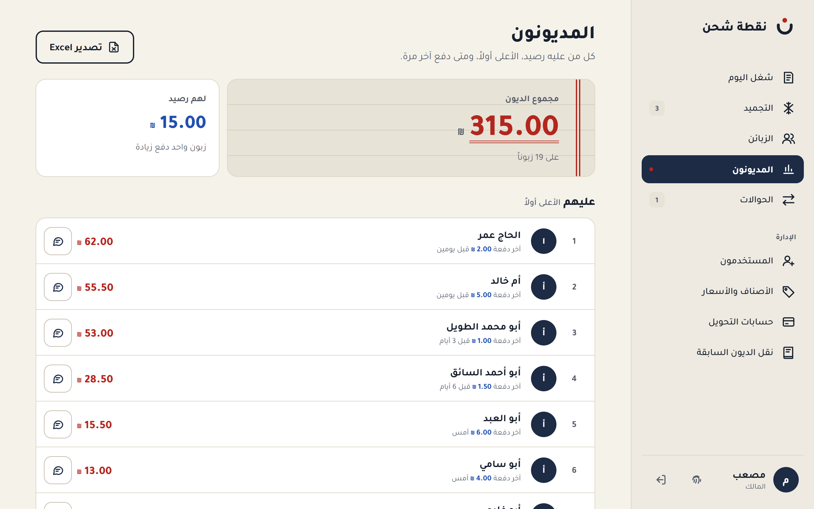 | 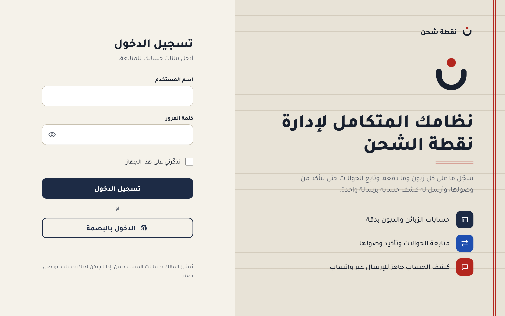 |
| **Debtors**: who owes, highest first | **Sign in**: password or fingerprint |

<p align="center">
  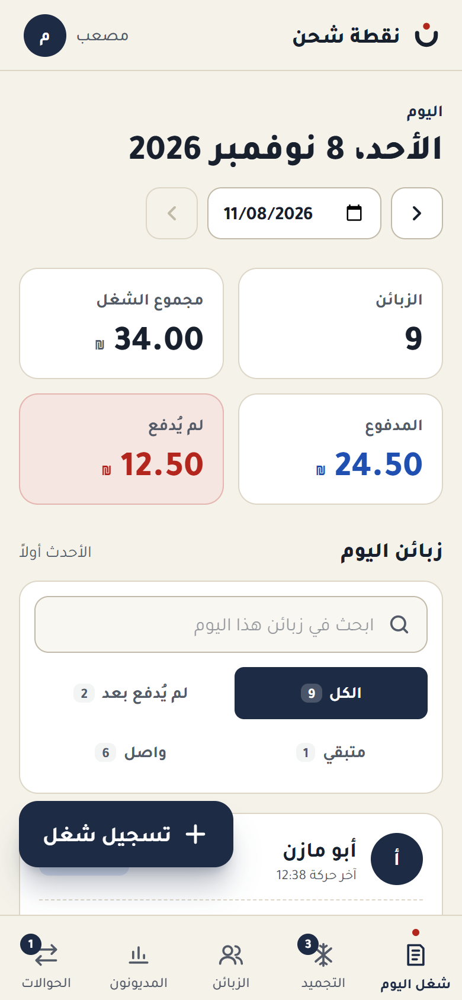
  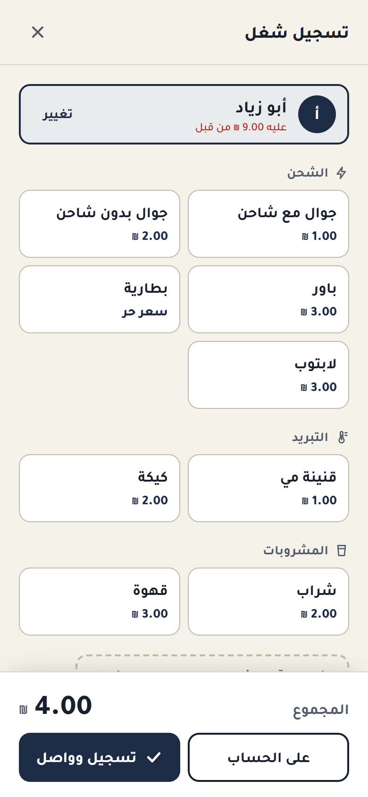
  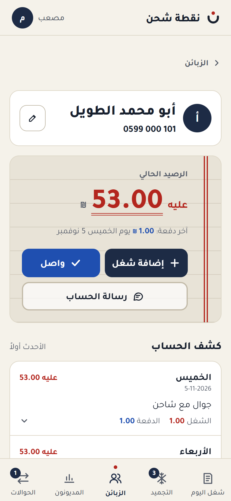
  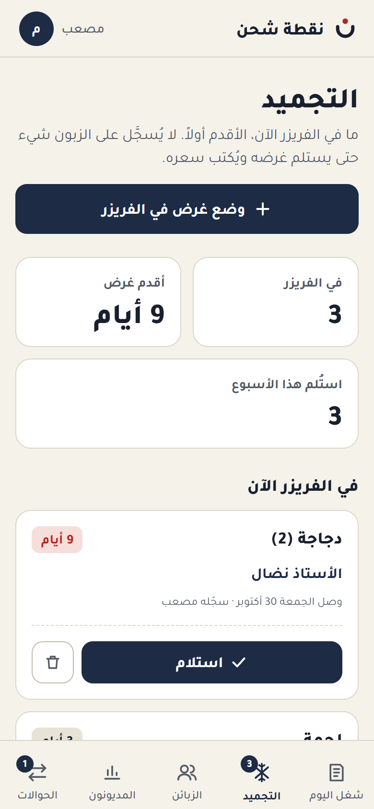
</p>

The interface is in Arabic, right to left. Every screenshot uses made-up demo data.

## How the accounts work

The rules are simple to say and easy to get wrong, so they live in the code and in the tests.

- **The balance is never stored.** It's the sum of a customer's debits minus their credits, worked out from the records every time (`Customer::balance()`, and one grouped query for the whole debtors list in `App\Support\Debtors`). There's nothing to fall out of sync.
- **Every item hits the account the moment it's recorded.** There's no "carry the day over to the debt notebook" step, so a balance is right at any hour.
- **A payment comes off the whole balance**, not a particular item. Paying part, paying ahead, or paying more than today's work to clear an old debt all just work.
- **A day's status comes from that day alone**: its items minus its payments (`App\Support\Movements`). A customer with an old debt who pays for today shows *paid* for today, and the old debt stays where it was.
- **Prices are stored with each item**, so changing the price list never rewrites history.
- **Records are never edited or deleted.** A mistake is fixed by a reversal: the opposite type, the same amount, on the original's moment, pointing back at it (`reverses_id`, unique, so nothing is reversed twice). The day's totals correct themselves, and who cancelled what, and why, stays on record.
- **Money is `decimal(10,2)`** in the database and `bcmath` in PHP. No floats anywhere near a shekel.
- **A form can't be recorded twice.** The save button locks after the first tap, and every form carries a token stored with a unique index, so a double tap on a slow connection records once. Anything that writes to more than one table runs in a database transaction, with row locks where two people could act at once.

## Tech stack

- **Laravel 13** (PHP 8.3+) with **Blade**: server-rendered pages, no API, no JavaScript framework.
- **Tailwind CSS 4**, an Arabic right-to-left layout built for the phone first and the laptop too, with design tokens for every color.
- **Plain JavaScript** in small behaviors (`resources/js/behaviors/`): the work window, the customer picker, form checks with messages in Arabic, live search.
- **MySQL / MariaDB** in production. **SQLite** works for trying it out and runs the tests.
- **Pest 4**: 249 tests covering the balance rules, reversals, double submits, the statement, the account message, the freezer, permissions and more.
- **laravel/passkeys** for fingerprint sign-in, **OpenSpout** for the Excel export.

## Run it locally

You need PHP 8.3+, Composer and Node.js.

```bash
git clone https://github.com/musab-darwish/charging-point.git
cd charging-point
composer install
npm install
npm run build
cp .env.example .env
php artisan key:generate
```

The quickest database is SQLite. In `.env`, set `DB_CONNECTION=sqlite` and remove the `DB_DATABASE` line, then create the file:

```bash
touch database/database.sqlite
```

(To use MySQL instead, keep `DB_CONNECTION=mysql` and create an empty `charging_point` database.)

Fill it with two weeks of made-up work up to today, and start the server:

```bash
php artisan migrate:fresh --seed --seeder=DemoSeeder
php artisan serve
```

Open http://localhost:8000 and sign in as **`demo`** / **`demo-password`**.

`DemoSeeder` refuses to run in production, on the real database, or on any database that already has records, so it can never mix made-up data with real accounts.

Run the tests:

```bash
php artisan test
```

## How it runs at the shop

The app runs on a laptop at the charging point. [Tailscale](https://tailscale.com) serves it over HTTPS to the phones on the owner's private network only, so there's no public server and no monthly bill. Scheduled tasks start it at logon and back the database up every night to a Google Drive folder, keeping the last 30 days (`php artisan backup:database`). When the internet is down, the notebook comes back out, and the records are entered later with their real date.

## What's next

Not built yet, on purpose: a board of which device is on which socket, drink stock with low-stock alerts, expenses, daily and monthly income reports, Excel exports beyond the debtors list, an editable message template, a credit limit per customer, working offline, and an English interface.

## Author

Built by **Musab Darwish** · [github.com/musab-darwish](https://github.com/musab-darwish)

## License

[MIT](LICENSE)
